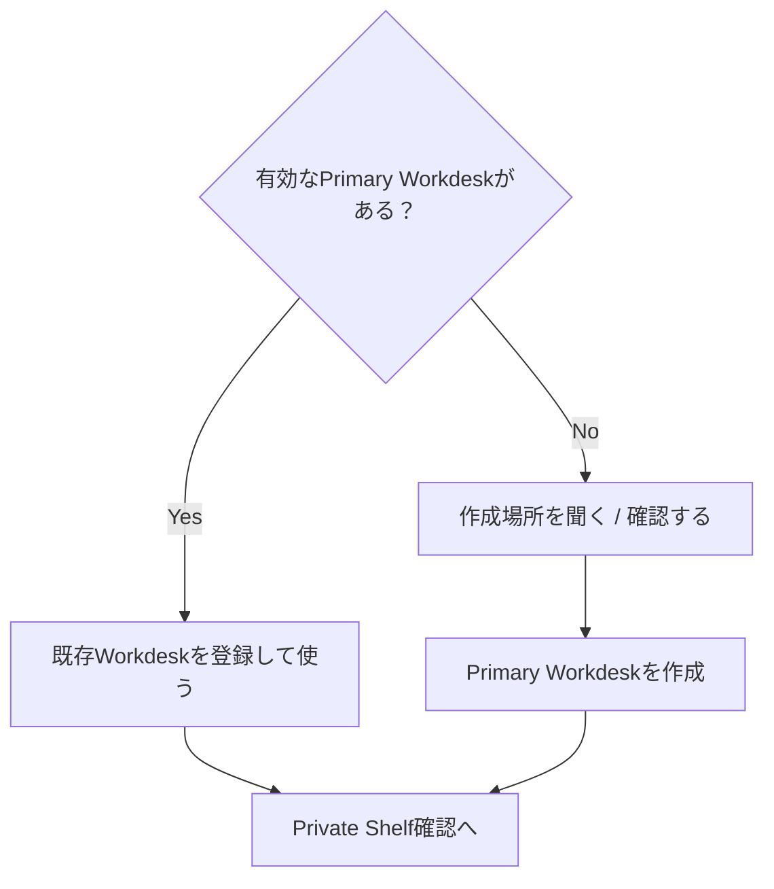
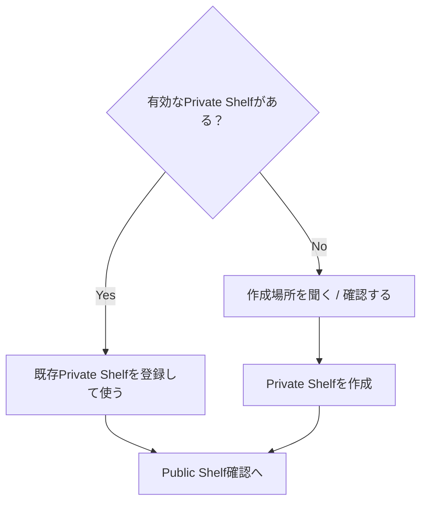
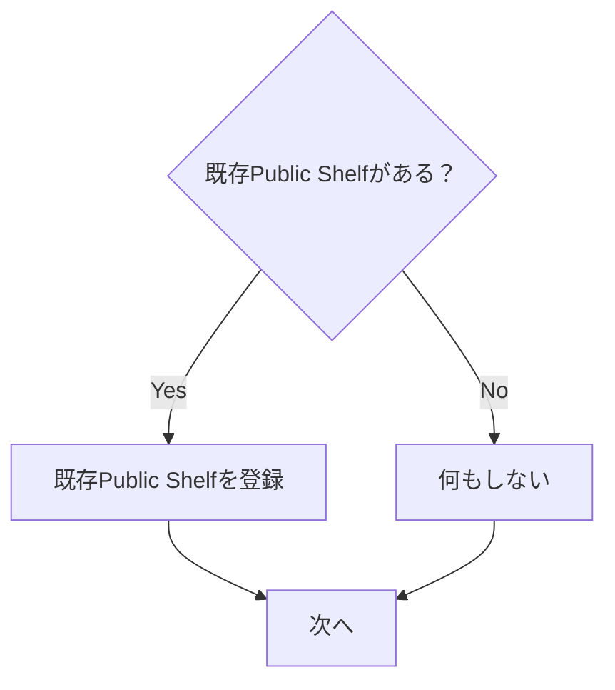

# First-run tutorial setup flow

対象は Git / Node / Python / PowerShell / PATH / package manager を知らない通常ユーザーです。

## 1. MAGINALIAの作業データを置く場所を確認

推奨Windows既定候補:

```text
Documents\MAGINALIA\
```

Program files と research/user data は分離します。

↓

## 2. Primary Workdesk



既存ファイルを上書きしない。選択先が不適切なら、日本語で理由を説明して別の場所を選べるようにします。

↓

## 3. Private Shelf



初回セットアップ後は必ず利用可能なPrivate Shelfが1つある状態にします。

↓

## 4. Public Shelf



Public Shelfは自動作成・自動公開しません。

↓

## 5. Tutorial quotation seed

`private-shelf-seed/` の3 Book / 3 Annotationを追加します。

- 冪等
- 既存Bookを勝手に置換しない
- 同一ID・別内容のAnnotationを上書きしない
- ページ番号を捏造しない
- 独立したseed itemは他の競合があっても可能な範囲で処理する

↓

## 6. Tutorial Project生成

Primary Workdesk の通常Project領域に

```text
MAGINALIA はじめてのプロジェクト
```

を生成します。

- fresh Repository UUID
- fresh Format Project ULID
- `.template` のplaceholderを実値へ置換
- 日本語filenameをUnicode/UTF-8で保持
- 同名Projectがあればcollision-safeに別名を作り、上書きしない

↓

## 7. Tutorial imageをDownloadsへ配置

元:

```text
resources/MAGINALIA_チュートリアル_宮沢賢治.jpg
```

Windows: `KnownFolder:Downloads`

Linux: `XDG_DOWNLOAD_DIR`

既定filename:

```text
MAGINALIA_チュートリアル_宮沢賢治.jpg
```

同名の別ファイルが存在する場合は上書きせずcollision-safe filenameを使い、生成するtutorial文面も実filenameに合わせます。

↓

## 8. Tutorial開始

`sample-a_マキナの置き手紙.md` を開きます。

ユーザーは順に:

1. Project文書を開く
2. Private Shelfを検索
3. QuoteRefを挿入
4. DownloadsからJPEGをDnD
5. draftを編集
6. body側のSynced Blockへ反映されることを確認
7. Preview / 自動参考文献を確認
8. resolved Markdownを書き出す
9. PDFを書き出す
10. DOCXを書き出す
11. Downloadsから3成果物を開く

↓

## 9. 完了

最後のDOCX出力成功後:

```text
チュートリアル完了！

はじめてのProjectを、
読むところから書き出すところまで一周しました。

[出力したファイルを見る]
[Workdeskへ戻る]
```

Tutorial Projectは通常Projectとして残し、後から自由に編集・削除できます。
