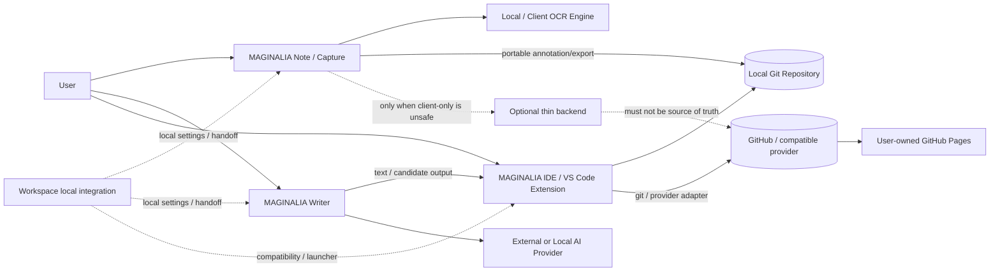
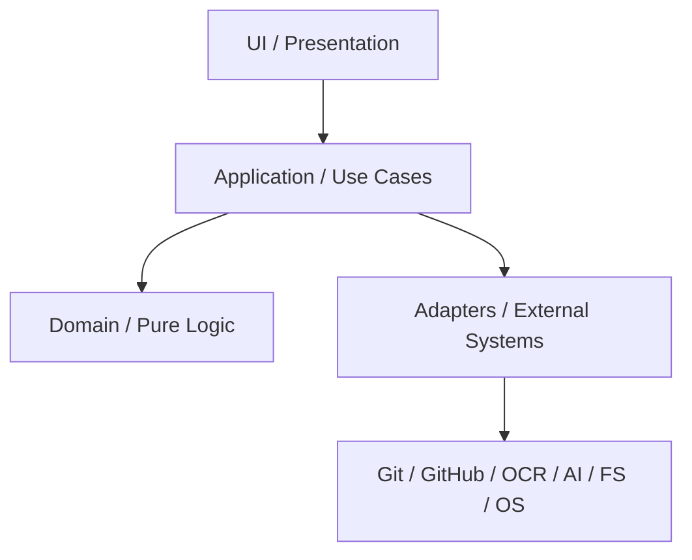
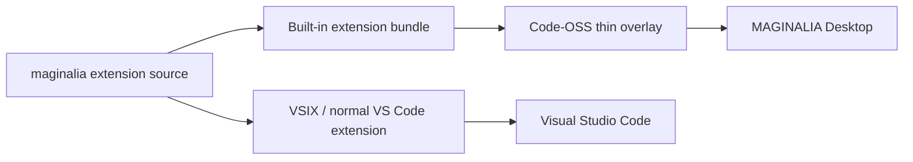
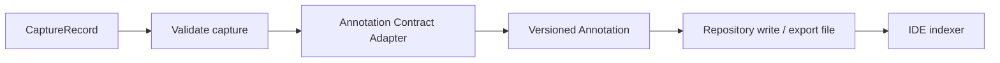
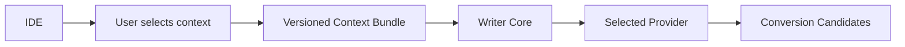
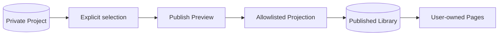
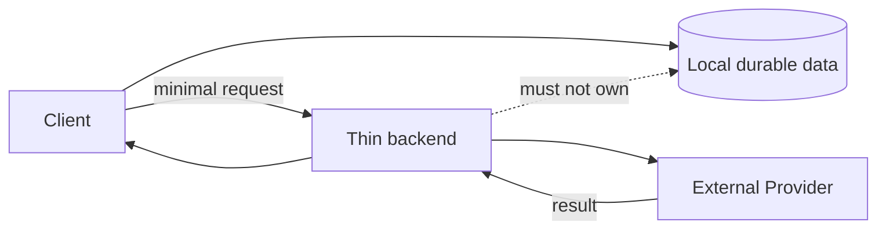

# MAGINALIA System Architecture

Status: target architecture for α1 → β1  
Date: 2026-08-16

## 1. System context

MAGINALIA は一枚岩の suite ではなく、portable contract で接続された複数 client です。



The optional backend is deliberately outside the core data path.

---

## 2. Common four-layer model

各 product は可能な限り同じ4層で考えます。



### Rules

- Domain は外部 API client を import しない。
- UI は GitHub / OCR / AI provider の response shape を直接解釈しない。
- Adapter は provider 固有 error を application-level error へ変換する。
- file format の parse / validate は UI から独立する。
- external service unavailable でも local work を失わない。
- unit は可能な限り pure function + narrow interface にする。

---

## 3. Canonical shared contracts

共通化する対象は実装ではなく **意味** です。

### 3.1 Stable identifiers

最低限、以下に stable ID を持たせます。

- Project
- Book / Source
- Annotation
- Output document
- Context bundle
- Publication

ID は filename、title、UI label と同一視しません。

### 3.2 Versioned schemas

```text
Marginalia Format
├ project
├ source / book
├ annotation
├ output metadata
├ publication projection
└ context bundle
```

各 schema は version を明示し、migration は pure function として test します。

### 3.3 Repository layout

正本は ordinary repository です。

```text
project/
├ .marginalia/
│  └ project.yml
├ notes/
├ sources/
├ annotations/
├ outputs/
├ assets/
└ README.md
```

local cache / index は削除して再生成可能であることを条件に許可します。

---

## 4. Product boundaries

### 4.1 MAGINALIA IDE

**Owns**

- Research Project create/open
- portable data read/write
- humanities-oriented navigation
- Markdown editing / preview
- annotation reference resolution
- humanized Git UX: Changes / Update / Sync
- publication preview / projection
- integration extension points

**Does not own**

- OCR engine
- AI model
- cloud database
- Git implementation
- general-purpose compiler/build IDE

### 4.2 MAGINALIA Note / Capture

**Owns**

- ISBN / source identification
- image capture
- region selection
- local/client OCR
- human correction
- portable annotation creation
- local working state
- export / repository adapter

**Does not own**

- long-form writing
- research project editing
- canonical Git history UI
- server-side OCR as a requirement

### 4.3 MAGINALIA Writer

**Owns**

- rough input normalization
- candidate generation
- human review
- user-controlled context consumption
- provider abstraction
- mechanical fallback

**Does not own**

- research repository ownership
- automatic full-repo ingestion
- document publishing
- mandatory cloud inference

### 4.4 Workspace β1

Workspace は cloud account system ではなく、まず **local integration profile + launcher + compatibility layer** とします。

**Owns**

- installed product detection
- version compatibility check
- shared local settings where safe
- Research Project handoff
- explicit context bundle handoff
- common deep-link conventions
- diagnostics report
- optional download/update discovery

**Does not own**

- required user account
- cloud sync
- hosted research DB
- mandatory remote policy server
- telemetry backend
- proprietary copy of the same domain logic

---

## 5. IDE dual-distribution architecture

同じ MAGINALIA extension codebase を二形態で使います。



### Extension-first rule

次は extension API で実装することを優先します。

- commands
- Tree Views / View Containers
- project overview
- status / notifications
- custom preview
- source / annotation navigation
- publish UI

Webview は native API で表現しにくい複合 UI に限定します。

### Core patch rule

Code-OSS core patch が許されるのは、以下の全てを満たすときだけです。

1. Desktop UX に必須
2. extension API では実現不能または著しく不自然
3. upstream patch surface が小さい
4. patch manifest に列挙できる
5. dedicated ADR がある
6. VS Code extension 版は core patch 無しでも主要 workflow が使える

---

## 6. Repository Provider boundary

Application は GitHub 固有 API を直接呼びません。

```text
RepositoryProvider
├ LocalGitProvider
├ GitHubCliProvider
├ GitHubApiProvider
└ future providers
```

Conceptual interface:

```ts
interface RepositoryProvider {
  getStatus(): Promise<RepositoryStatus>;
  sync(): Promise<SyncResult>;
  publishUpdate(message: string): Promise<UpdateResult>;
  getRemoteUrl(): Promise<string | null>;
}
```

GitHub を第一級に使うことと GitHub response shape に core を固定することは別です。

---

## 7. Note → IDE contract

Note は IDE internal database を書きません。



Raw image / OCR intermediate data は public annotation projection へ自動混入させません。

---

## 8. IDE → Writer context contract

Writer は repository 全体を常時読む権限を持ちません。



Context Bundle は必要最小限で、由来と期限を持てる設計を優先します。

例:

```yaml
version: 1
project_id: proj:...
created_at: ...
items:
  - type: glossary
    path: notes/glossary.md
  - type: excerpt
    source_id: src:...
    text: ...
```

---

## 9. Publication architecture

private source と public output を同一視しません。



Rules:

- copy-all 禁止
- public projection は allowlist で構築
- image / raw OCR / device metadata / local path は default deny
- publish failure は private source を変更しない

---

## 10. Optional backend boundary

Backend は system-of-record になりません。



Acceptable examples:

- OAuth code exchange
- signed download metadata
- tiny redirect / compatibility endpoint

Not acceptable for β1 core:

- research document database
- mandatory annotation sync service
- server-side user profile as the only copy

---

## 11. Failure-domain design

| Failure | User must still have |
|---|---|
| GitHub unavailable | local repository and edits |
| OCR engine fails | captured image / manual entry path |
| Writer AI provider fails | rough input + mechanical fallback |
| Workspace unavailable | each standalone product |
| optional backend unavailable | local/export path |
| Code-OSS upgrade breaks overlay | last known build + VS Code extension path |
| index/cache corrupts | original Markdown/YAML/JSON and rebuild command |

---

## 12. Architecture smell checklist

実装前 review で1つでも Yes なら分割を検討します。

- UI component が GitHub token を知っている
- OCR result object が project domain の正本になっている
- Writer が repository path を勝手に探索する
- Note が IDE internal cache を直接書く
- Workspace が standalone product の logic をコピーしている
- service が落ちると local file を開けない
- schema version なしの cross-product JSON が増える
- Code-OSS core patch でしか説明できない UI が急増する
