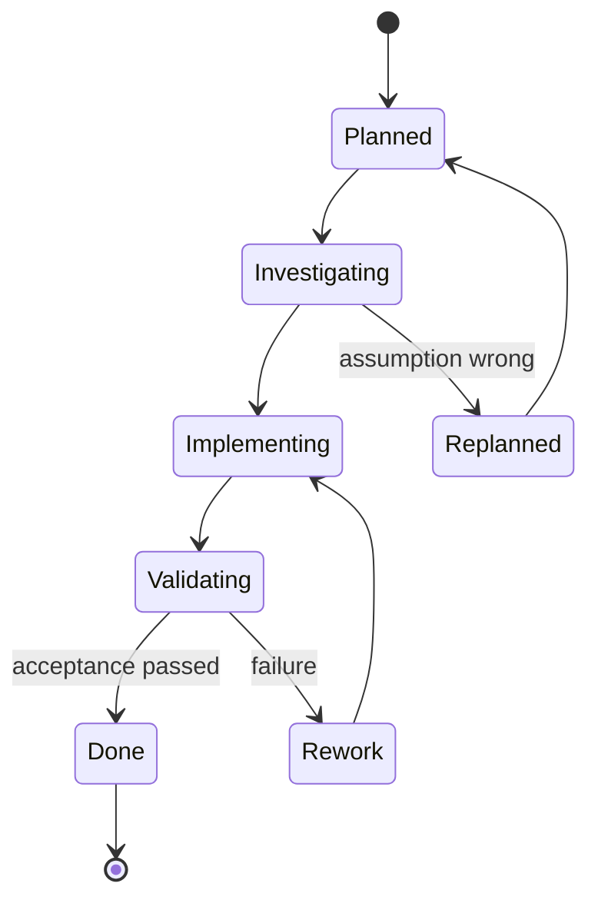
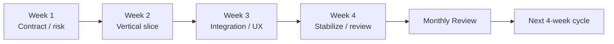

# Development Cadence

Status: working process  
Date: 2026-08-16

MAGINALIA は Codex の実行量が週単位で更新されることを前提に、**1週間 = 1 sprint / 4 sprint = 1 planning cycle** とします。

目的は「毎週たくさんコードを書く」ことではなく、token を局所戦へ集中させて毎週ひとつ説明可能な境界を完成させることです。

---

# 1. One-week sprint

## Sprint rule

1 sprint に入れる **Primary Outcome は1つ**。

Bad:

> IDE UIを刷新し、Note同期を作り、Writerも統合する。

Good:

> Annotation v1 contract を定義し、IDE と Note の双方で同じ fixture を通す。

## Weekly allocation

目安:

- 60%: Primary Outcome implementation
- 20%: tests / failure paths / refactor
- 10%: docs / Mermaid / ADR
- 10%: unknowns / integration buffer

最後の10%を最初から新機能で埋めません。

---

# 2. Sprint lifecycle



## A. Plan

Sprint開始時に `plan/sprints/YYYY-Www.md` または対応 Issue に次を書きます。

- Primary Outcome
- why now
- in scope
- out of scope
- touched units
- acceptance tests
- relevant ADR / contract
- expected artifacts

## B. Investigate

外部仕様に依存する場合だけ、実装前に一次情報を確認します。

Examples:

- Code-OSS / VS Code API
- GitHub auth / permissions
- Android API changes
- browser camera / storage constraints
- provider API

調査だけで sprint を溶かしません。決めきれない点は adapter 境界の後ろへ隔離します。

## C. Implement

- small commits
- one responsibility per unit
- no unrelated cleanup
- no drive-by framework migration
- cross-product behavior は contract fixture を先に置く

## D. Validate

- unit tests
- contract tests
- integration test for changed boundary
- manual happy path
- manual failure path

## E. Explain

Done 前に以下を更新します。

- relevant architecture doc
- Mermaid flow if flow changed
- Decision Log
- ADR if required
- next known risk

---

# 3. Definition of Ready

Sprintへ入れてよい条件:

- 解く問題が一文で説明できる
- primary user が明確
- current milestone に必要
- touched units が列挙できる
- external dependency が分かる
- success criteria が観測可能
- explicit non-goal がある
- rollback / fallback がある

これを満たさない feature は backlog へ戻します。

---

# 4. Definition of Done

Done は「コードが動いた」ではありません。

必須:

1. acceptance criteria pass
2. relevant unit tests pass
3. contract test pass if boundary changed
4. failure path tested
5. docs updated
6. Mermaid updated if flow changed
7. technical terminology is not leaked into normal UI without reason
8. portable data remains readable without the feature
9. no new secret or backend dependency without decision record
10. non-programmer explanation can be written in 5-10 sentences

---

# 5. Codex work packet

Codexへ渡す作業は、大きな「完成させて」ではなく packet に切ります。

Recommended packet structure:

```text
Context
- read these files
- current branch / repo

Goal
- one primary outcome

Do
- exact units
- exact interfaces
- exact tests

Do not
- adjacent features
- package upgrades
- unrelated refactor

Acceptance
- commands/tests
- human workflow

Report
- changed files
- decisions
- unresolved risks
```

## Token discipline

Token残量が苦しくなったら:

1. acceptance path を先に完成
2. tests を完成
3. docs / decision log を完成
4. cosmetic cleanup は次 sprint

途中で次の大機能へ飛びません。

---

# 6. Branch / PR strategy

原則:

```text
main
  └ agent/<sprint-outcome>
       └ draft PR
```

PR は一つの Primary Outcome を表します。

Separate PR when:

- contract/schema change
- Code-OSS core patch
- security/auth change
- dependency major upgrade
- migration

同じ PR に混ぜない。

---

# 7. Four-week planning cycle



典型的な配分:

### Week 1: Contract / risk reduction

- schema
- interface
- technical spike
- feasibility matrix

### Week 2: Vertical slice

- end-to-end happy path

### Week 3: Integration / beginner UX

- adjacent product connection
- errors
- terminology
- onboarding

### Week 4: Stabilize

- migrations
- tests
- docs
- clean build
- scope review

これは固定ではなく、月次で変更できます。

---

# 8. Monthly review

4週間ごとに `plan/reviews/YYYY-MM.md` を作ります。

## 8.1 Review questions

### Product

- 今月、何本の end-to-end flow が新しく通ったか
- α1 / β1 gate のどこまで進んだか
- 実装したが利用者価値に繋がらなかったものは何か

### Architecture

- 新しい coupling は増えたか
- adapter boundary は守れたか
- portable source of truth は守れたか
- optional backend が core dependency になっていないか

### UX

- PCに詳しくない利用者に新しく要求してしまった知識は何か
- 専門用語を通常UIへ漏らしていないか
- 初期設定の操作数は増えたか減ったか

### Quality

- flaky test
- migration debt
- unresolved security issue
- undocumented decision

### Development economics

- Codex token を最も消費した箇所
- 手戻りが多かった箇所
- 次月に spike を先行すべき不確実性

---

# 9. Monthly re-planning rule

進捗遅延時に milestone を無条件で後ろへずらしません。

順序:

1. current goal を再確認
2. nonessential scope を削る
3. manual fallback を許容する
4. specialist tool / existing library に任せる
5. architecture boundary を保ったまま implementation を単純化
6. それでも無理なら milestone を再設定

「遅れたので品質を削る」は最後まで選びません。

---

# 10. Scope change budget

Sprint中の新アイデアは3分類します。

## A. Blocking

現在の Primary Outcome が成立しない。

→ sprint に入れてよい。

## B. Risk reduction

今直さないと data loss / security / compatibility risk が高い。

→ Primary Outcome と入れ替えるか、小さいなら入れる。

## C. Nice-to-have

便利、きれい、将来欲しい。

→ backlog。今週はやらない。

---

# 11. Decision cadence

## Small decision

Decision Log へ1行。

## Architectural decision

ADR。

Examples:

- format version
- auth flow
- backend introduction
- repository topology
- Code-OSS patch
- provider contract
- data migration

## Product decision

Product Goals / Manifest を更新。

「コードに書いてあるから仕様」は禁止します。

---

# 12. Human review checkpoint

毎月、最低1回は **開発者ではない文系ユーザーの視点** で操作を確認します。

見るもの:

- installer
- first run
- terminology
- blank state
- error message
- Sync
- Publish

成功条件は「説明すれば使えた」ではなく、説明なしで主要導線を通れることです。
