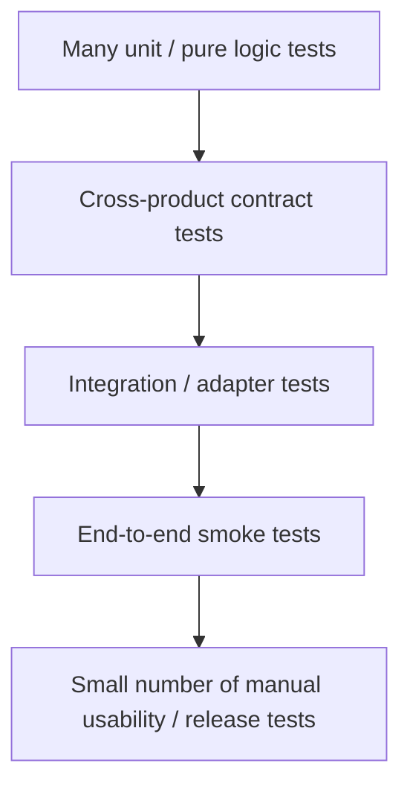
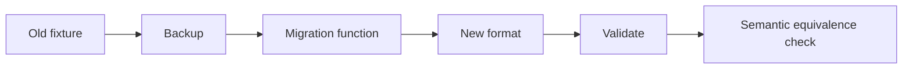

# Quality and Testing Strategy

Status: normative quality policy  
Date: 2026-08-16

MAGINALIA の品質目標は「全部を自動テストする」ことではありません。

**壊れたときに研究データを失わず、どの unit が壊れたか説明でき、cross-product contract の互換性を検出できること**を優先します。

---

# 1. Test pyramid by responsibility



重点は Unit + Contract。

---

# 2. Unit test policy

Unit test を必須にする対象:

- schema validation
- ID generation / parsing
- path validation
- format migration
- publication allowlist projection
- OCR/capture coordinate normalization
- ISBN validation
- bibliography normalization
- Writer mechanical normalization
- placeholder protection / restore
- provider response validation
- user-facing error mapping
- context bundle creation

Pure logic を UI から分ける理由の一つは、ここを安価に test するためです。

---

# 3. Contract tests

Cross-product object は repository ごとに勝手な fixture を作りません。

Canonical fixture set を `MAGINALIA_IDE` 側の format/spec として持ち、consumer repo でも同じ意味を検証します。

Example:

```text
fixtures/
├ annotation/
│  ├ valid-minimal-v1.json
│  ├ valid-with-extension-v1.json
│  ├ invalid-missing-source.json
│  └ future-version.json
├ project/
└ context-bundle/
```

Contract change では最低限:

1. old valid fixture remains valid or migration exists
2. new fixture validates
3. consumer can parse it
4. unknown/future version behavior is explicit
5. public projection excludes forbidden fields

---

# 4. Adapter tests

外部 service は adapter 境界の behavior を test します。

Examples:

## RepositoryProvider

- remote unavailable
- auth failure
- clean sync
- remote ahead
- conflict required
- no remote configured

## BibliographyProvider

- successful ISBN lookup
- missing book
- partial metadata
- malformed response
- offline

## OCR adapter

- success
- empty result
- engine failure
- vertical/horizontal mode selection

## Writer provider

- valid response
- timeout
- invalid payload
- protected placeholder corruption
- provider unavailable

External API を unit tests のたびに実呼び出ししません。

---

# 5. Integration tests

Integration tests は「二つの unit の境界」を狙います。

Priority:

1. format parser ↔ repository files
2. Note CaptureRecord adapter ↔ canonical Annotation
3. IDE Annotation indexer ↔ canonical fixture
4. IDE publisher ↔ public projection
5. IDE context selector ↔ Context Bundle
6. Writer Context Bundle parser ↔ provider payload builder
7. RepositoryProvider ↔ local Git fixture repo

---

# 6. End-to-end smoke tests

E2E は本数を増やしすぎません。

## IDE α1 smoke

```text
create project
→ create Markdown
→ create annotation
→ reference annotation
→ Update
→ Sync test remote
→ Publish preview
```

## Note α1 smoke

```text
ISBN
→ metadata
→ image fixture / capture abstraction
→ crop
→ OCR fixture
→ human correction
→ canonical export
```

## Writer α1 smoke

```text
rough input
→ mechanical
→ provider adapter
→ fallback path
→ review candidate
→ accept
```

## Workspace β1 smoke

```text
Note export
→ IDE import
→ IDE Context Bundle
→ Writer consume
→ IDE output
→ Update / Sync
→ static publish
```

---

# 7. Migration tests

Format version を変更するたびに:



Migration requirements:

- no in-place destructive migration without backup
- deterministic where possible
- idempotence checked when applicable
- error leaves old source intact
- user-facing summary is generated

---

# 8. Publication privacy tests

Publication is security/privacy-sensitive and gets explicit negative tests.

Forbidden-by-default examples:

- raw capture image
- full-page OCR
- device-local path
- token / credential
- device metadata
- unpublished comment
- private memo
- local cache content

Test:

> A private fixture containing every forbidden field must produce a public projection containing none of them.

Allowlist, not denylist, remains the default.

---

# 9. UI behavior tests

UI automated test は business logic test の代わりにしません。

重点:

- first-run primary actions exist
- blank state is usable
- domain terminology is shown
- normal UI does not require Git jargon
- error message contains: what happened / what is safe / next action
- Advanced detail is reachable
- keyboard navigation for primary actions

---

# 10. Beginner usability testing

β1 gate では automated tests だけでは不十分です。

Target participant:

- 文系学生 / 研究者
- Git knowledge: none or minimal
- terminal use: not required

Task script:

1. install
2. create project
3. write note/output
4. inspect a quote
5. leave history
6. connect/sync GitHub
7. preview publication

Measure:

- completion without help
- where technical vocabulary blocks progress
- number of external setup steps
- user expectation vs actual action
- recovery after one simulated error

Do not grade the user. Grade the product.

---

# 11. Release gates

## α1

Required:

- all unit tests pass
- canonical contract tests pass
- one end-to-end smoke path
- no known data-loss bug in primary flow
- manual recovery path documented
- docs + Mermaid match implementation

Allowed:

- rough UI
- manual export/import
- incomplete installer
- known non-critical UX friction

## β1

Required in addition:

- migration tests
- clean machine install
- first-run usability pass
- conflict/auth/offline recovery UX
- packaging reproducibility
- dependency/license review
- contract compatibility matrix
- backup/export path

---

# 12. CI policy

CI should be fast at the repo level and expensive only where needed.

## Every PR

- lint/typecheck
- unit tests
- contract tests
- format validation
- docs link/schema checks where practical

## Relevant PR only

- integration tests
- VS Code extension test host
- Android build
- packaging smoke

## Scheduled / release

- full pinned Code-OSS build/package
- clean environment reproducibility
- optional longer cross-repo contract matrix

---

# 13. Test ownership

A unit owns its tests.

```text
unit code
unit tests
public interface
fixtures only if domain-specific
```

Cross-product fixture is owned by the canonical contract, not copied and edited independently.

---

# 14. Bug priority

P0:

- data loss
- credential leak
- private data published

P1:

- cannot open project
- migration breaks project
- primary workflow blocked
- sync corrupts history

P2:

- recoverable feature failure
- severe UX confusion

P3:

- cosmetic / low-impact convenience

P0/P1 can interrupt a sprint. P2/P3 normally wait for planning.

---

# 15. Quality invariant

Before merging a change, ask:

> If this feature disappears or fails tomorrow, can the user still understand and recover their research data?

If the answer is no, the data boundary needs redesign before more tests are added.
