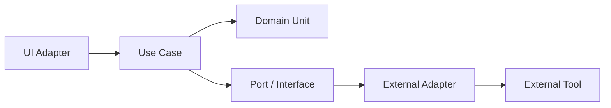
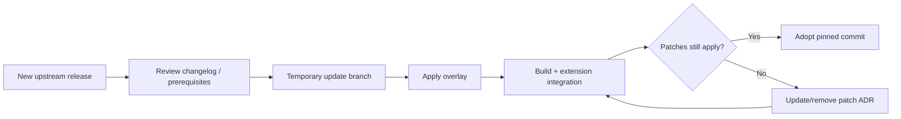

# Maintenance and OSS Extension Policy

Status: target policy  
Date: 2026-08-16

MAGINALIA の保守性は「代表者がコードを直せること」ではなく、**壊れた場所・交換可能な場所・責任者に渡すべき範囲を説明できること**で作ります。

---

# 1. Unit model

各機能を次の形へ寄せます。



Example: ISBN

```text
UI
└ Scan ISBN button

Use case
└ AddBookFromISBN

Domain
├ ISBN validation
└ BookMetadata model

Port
└ BibliographyProvider

Adapters
├ OpenBDProvider
└ future NDL/other provider
```

OpenBD が変わっても ISBN validation や UI 全体を書き換えない構造が目標です。

---

# 2. Dependency rule

Allowed:

```text
UI -> application -> domain
application -> interface
adapter -> interface + external SDK
```

Avoid:

```text
UI -> external API response
Domain -> GitHub SDK
Domain -> VS Code UI
Note -> IDE internal class
Writer -> Project filesystem crawler
Workspace -> copied Note/Writer logic
```

---

# 3. Extension surfaces

OSS contributor が入りやすい場所を意図的に作ります。

## 3.1 Repository Provider

Use cases:

- GitHub
- GitLab
- Forgejo
- local-only

Contract examples:

- status
- sync
- publish update
- remote identity

Provider-specific login/config is adapter responsibility.

## 3.2 Bibliography Provider

Use cases:

- openBD
- NDL APIs
- library catalog adapters

Canonical output:

`BookMetadata`

## 3.3 OCR Provider

Use cases:

- Tesseract.js
- ML Kit
- NDL OCR
- OS/native OCR

Canonical output should be a small OCR result contract, not engine-specific raw JSON.

## 3.4 Writer Provider

Use cases:

- mechanical only
- local OpenAI-compatible
- OpenAI
- Gemini
- future dedicated model

Core UI should ask capability, not model brand behavior.

## 3.5 Renderer / Exporter

Use cases:

- HTML preview
- vertical preview
- static shelf
- future PDF
- future DOCX

Input should be Marginalia AST / portable document model where appropriate.

## 3.6 Importer

Use cases:

- generic Markdown
- canonical annotation JSON
- future Word
- legacy APK publication contract

Importer converts into canonical domain; it does not redefine canonical domain.

---

# 4. Schema extension policy

Canonical core schema stays small.

Product-specific data may use an explicit extension namespace.

Conceptual example:

```json
{
  "version": 1,
  "id": "ann:...",
  "source_id": "src:...",
  "quoted_text": "...",
  "extensions": {
    "dev.maginalia.capture": {
      "local_image_id": "...",
      "region": [0.1, 0.2, 0.5, 0.3]
    }
  }
}
```

Rules:

- core consumer can preserve unknown extension payload without understanding it where safe
- public projection does not publish unknown extension payload by default
- extension namespace ownership is documented
- extension cannot change meaning of required core fields

Exact schema behavior is finalized in the format ADR/spec, not this example.

---

# 5. Capability discovery

Cross-product integration should prefer capability checks over exact product assumptions.

Bad:

```text
if WriterVersion == 0.1.7 then ...
```

Better:

```text
supports:
- context-bundle/v1
- writer-candidate/v1
```

Workspace compatibility can still maintain version ranges, but contract capability is the semantic basis.

---

# 6. Compatibility levels

## Level A: File-compatible

Tool can read ordinary Markdown/YAML/JSON even without MAGINALIA-specific features.

## Level B: Contract-compatible

Tool understands a versioned MAGINALIA object.

## Level C: Workflow-compatible

Tool participates in a handoff such as Note → IDE.

## Level D: Integrated UX

Workspace / deep link makes the handoff seamless.

A tool does not need Level D to be a valid ecosystem member.

---

# 7. Versioning policy

## Data contracts

- explicit version
- migration before destructive changes
- deprecation window
- fixture for every supported major version

## Product versions

Product version and data format version are separate.

Example:

```text
MAGINALIA IDE 0.4.0
supports:
- project/v1
- annotation/v1
- context-bundle/v1
```

Do not infer file compatibility from app version alone.

---

# 8. Deprecation policy

Before removing a contract/provider:

1. mark deprecated in docs
2. provide replacement
3. add conversion/export path
4. keep read support for a defined period when feasible
5. remove only after a migration test exists

No silent schema deletion.

---

# 9. Code-OSS upstream maintenance

The Code-OSS overlay is a maintenance hotspot and must stay deliberately boring.



Rules:

- never track floating `main`
- pin release + commit
- each core patch has removal condition
- upstream update is its own sprint/PR when nontrivial
- product feature sprint does not casually update Code-OSS

---

# 10. Backend maintenance

Every MAGINALIA-operated backend component needs an owner card:

```text
Purpose:
Why client/static/GitHub cannot do it:
State stored:
Secrets:
Expected traffic:
Failure behavior:
Cost ceiling:
Replacement/removal path:
```

If this card cannot be filled in simply, backend scope is too large.

---

# 11. Documentation required per unit

Each nontrivial unit should have either colocated README/docstring or architecture entry describing:

- one-sentence responsibility
- input
- output
- durable data touched
- external dependencies
- errors/fallback
- tests
- extension point

Do not document every private function. Document the boundary.

---

# 12. Non-programmer maintenance map

Project owner should be able to triage a bug using this table.

| Symptom | Likely unit | Specialist |
|---|---|---|
| ISBN is rejected | ISBN domain / scanner | web/mobile developer |
| Book data missing | bibliography adapter | API/web developer |
| OCR is wrong | OCR adapter / engine | OCR/mobile specialist |
| Quote lost after export | Annotation adapter/contract | format/application developer |
| Project will not open | Format validator / filesystem adapter | core developer |
| Sync fails | RepositoryProvider / Git | Git integration developer |
| Vertical preview broken | renderer | web/CSS/CJK developer |
| Writer produces bad fallback | normalizer | Python/NLP developer |
| Cloud candidate fails | Writer provider adapter | API developer |
| Installer asks for terminal commands | distribution/onboarding | release engineer |
| Code-OSS update breaks UI | overlay/core patch | Code-OSS specialist |

This is the practical meaning of「餅は餅屋」です。

---

# 13. Contribution granularity

Good first external contributions:

- new bibliography adapter
- fixture/test improvement
- language translation
- static renderer theme
- error message improvement
- documentation

Intermediate:

- OCR adapter
- repository provider
- new importer/exporter
- CJK rendering feature

Maintainer-level review required:

- schema breaking change
- publish privacy boundary
- auth
- core Code-OSS patch
- migration
- credential handling

---

# 14. Redundancy rules

Good redundancy:

- export/import + direct integration
- local-only + GitHub sync
- mechanical Writer fallback + AI provider
- Desktop + VS Code extension
- web Note + native reference

Bad redundancy:

- two unrelated canonical Annotation schemas
- same domain logic copied into Workspace
- multiple ad-hoc Git implementations
- separate user identity systems per product

Redundancy must provide an escape route or independent failure domain, not merely duplicate maintenance.

---

# 15. Architecture review question

Before accepting a new feature, ask:

> Can a contributor replace this external dependency by implementing one documented interface, without rewriting the surrounding product?

If not, divide the unit again before scaling it.
