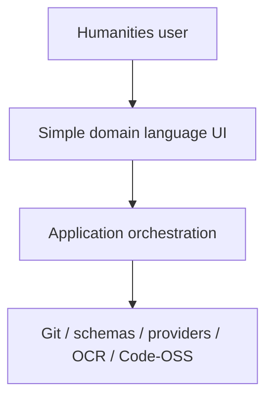
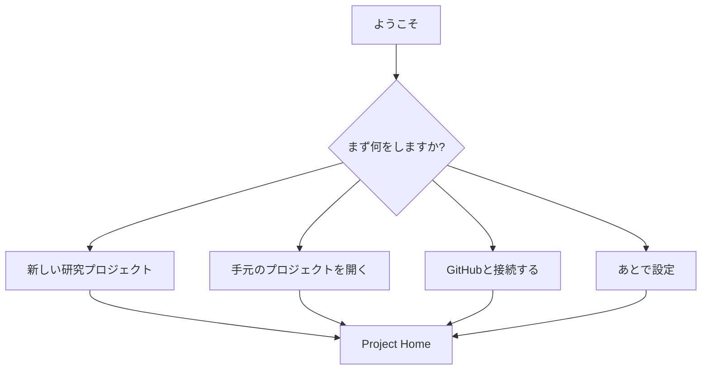

# UX Principles: Simple Outside, Complex Inside

Status: normative product UX policy  
Date: 2026-08-16

## 1. Primary user

MAGINALIA の第一利用者は、**PCやGitに詳しくない文系学生・研究者・書き手**です。

開発者向けの便利さは重要ですが、通常モードの設計判断を支配しません。

利用者に期待しない知識:

- Git / repository / branch / merge / rebase
- GitHub token / OAuth / SSH key
- JSON / YAML の手編集
- terminal / shell
- Node / Python / package manager
- environment variable
- build / compile / runtime
- API / endpoint

これらは裏側で使ってよい。通常 UI で理解を要求しない。

---

## 2. Core principle

> **見た目と操作は単純に、内部は必要なだけ複雑に。**

複雑さを消すのではなく、適切な層へ隔離します。



ユーザーが触る layer は「研究行為」を表現し、内部 layer は「技術実装」を処理します。

---

## 3. User vocabulary

通常モードでは次の語彙を優先します。

| Internal / advanced | Normal UI |
|---|---|
| repository | Research Project / Library / 保存先 |
| commit | Update / 履歴を残す |
| push | 同期する / 変更を送る |
| pull / fetch | 同期する / 最新にする |
| diff | Changes / 変更点 |
| branch | 作業の分岐 / Advanced only |
| merge conflict | 同じ場所が別々に変更されています |
| remote | オンライン保存先 |
| clone | このPCに開く |
| token | GitHubへの接続許可 |
| OAuth | GitHubと接続する |
| schema validation error | データ形式を確認できません |
| migration | 新しい形式へ更新する |
| provider | 使用するAI / 保存サービス / OCR |

技術用語を隠すことで原因まで隠してはいけません。

例:

```text
同期できませんでした。
このPCの変更は残っています。

[もう一度同期する]
[変更点を見る]
[詳しい情報]
```

`詳しい情報` の中では Git の具体的な状態を表示してよい。

---

## 4. Progressive disclosure

通常画面は少なく、詳細は必要なときだけ見せます。

### Normal mode

主要領域:

- Library
- Projects
- Sources / 引用
- Editor
- Changes / 履歴
- Publish

### Advanced mode

必要な利用者だけ:

- repository URL
- branch
- raw Git status
- YAML / JSON
- logs
- terminal access if distribution permits
- provider-specific configuration
- diagnostic detail

**Advanced を開かなくても基本 workflow が完結すること。**

---

## 5. Installation principle

### User experience goal

Windows で通常ユーザーが行うことは可能な限り:

1. 公式ページからダウンロード
2. インストーラーを開く
3. MAGINALIAを起動
4. 「はじめる」

までにします。

通常ユーザーへ要求しない:

- Node.js install
- Python install
- GitHub CLI install command
- PATH editing
- PowerShell command
- Visual Studio Build Tools
- dependency install

これらは **developer setup** のみに置きます。

### Git prerequisite

Gitが必要な機能を持つ場合でも、β1までに次のどちらかを成立させます。

A. installer が安全に同梱 / 導入できる

or

B. Git未導入でも local project が使え、同期設定時に分かりやすい導入 wizard を出す

「Gitを入れてPATHを通してください」で終わらせない。

---

## 6. First-run onboarding

初期設定は技術設定ではなく、利用目的から始めます。



GitHub接続は初回起動の必須条件にしません。

---

## 7. Settings principle

設定項目は「実装可能なものを全部出す」のではなく、利用者が判断できるものだけを通常 Settings に置きます。

Good:

- 表示言語
- 縦書き / 横書きの既定
- 自動保存
- GitHubと接続
- AIを使う / 使わない
- 送信する文脈の範囲

Advanced:

- remote URL
- executable path
- provider base URL
- timeout seconds
- schema debug mode

---

## 8. Error design

Error message は三層にします。

### Layer 1: what happened

> 同期できませんでした。

### Layer 2: what is safe

> このPCの変更は残っています。

### Layer 3: what to do

> [もう一度試す] [変更点を確認] [詳しい情報]

内部 exception / stack trace を主メッセージにしません。

---

## 9. Destructive action policy

削除、公開、migration、remote overwrite 等は「技術的な危険」ではなく「利用者が何を失うか」で説明します。

Bad:

> Force pushしますか?

Normal UI:

> オンライン側の履歴を置き換える操作はMAGINALIAでは行いません。

基本方針として force push を通常 UX から提供しません。

---

## 10. Publish UX

公開は Git operation ではなく editorial action です。


公開前に「何が外へ出るか」を人間が読める形で確認できること。

---

## 11. Visual simplicity

通常画面では情報密度を抑えます。

- 主要 action は画面ごとに1つか2つ
- icon-only action を増やしすぎない
- tree の深い nesting を避ける
- status bar に常時大量の状態を出さない
- modal dialog を連発しない
- technical logs は通常非表示
- product color は accent に限定
- White / Black / Graphite + MAGINALIA Blue を基本にする

見た目を独自化するためだけの Webview / core patch は避けます。

---

## 12. Code-OSS / VS Code reality

VS Code Extension API は多くの UI contribution を提供しますが、extension は VS Code workbench の DOM や任意 CSS を直接変更できません。

そのため「UI刷新」は二段階で扱います。

### Stage A: extension-first simplification

- MAGINALIA View Container
- minimum Views
- Project Home / Welcome
- domain terminology
- commands / context actions
- hide developer concepts from primary navigation where supported

### Stage B: Desktop-only workbench simplification spike

Stage A で beginner UX が成立しない場合だけ、Code-OSS overlay / small core patches を調査します。

変更候補ごとに:

- extension API で可能か
- product configuration で可能か
- upstream setting/default で可能か
- core patch が必要か

の feasibility matrix を作り、patch は ADR にします。

通常 VS Code extension 版は、Desktop専用 patch がなくても主要 domain workflow が使えることを守ります。

---

## 13. Usability acceptance

β1 の UI は、開発に参加していない文系ユーザーが次を説明書なしで完了できることを目標にします。

1. インストール
2. 新規プロジェクト作成
3. Markdownを書く
4. 引用を見る
5. 変更履歴を残す
6. GitHubへ同期
7. 公開プレビュー

テスト後に「Gitとは何かを理解したからできた」は失敗です。

**MAGINALIAの操作を理解したからできた**状態を目指します。
