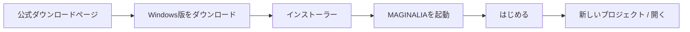
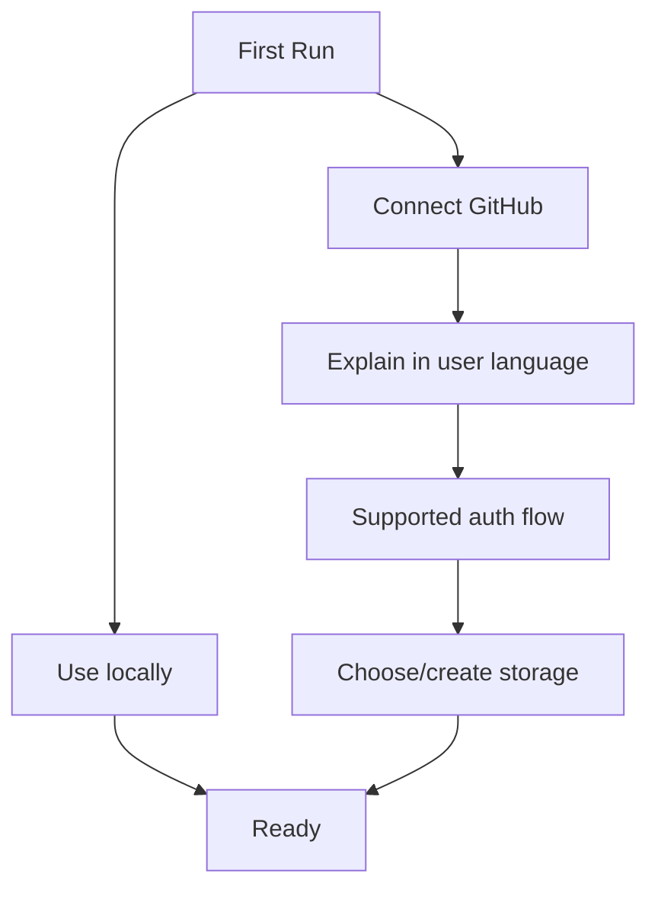

# Distribution and Onboarding Plan

Status: target distribution policy  
Date: 2026-08-16

MAGINALIA は「PCに詳しくない文系ユーザー」が第一利用者です。

そのため、**開発環境の構築方法と利用者のインストール方法を完全に分離**します。

---

# 1. User installation target

β1 の Windows 利用者に見せる理想導線:



通常利用者に要求しないもの:

- terminal
- PowerShell command
- Node.js
- Python
- npm / pip / uv
- Visual Studio Build Tools
- PATH
- manual environment variables
- VSIX install command
- JSON/YAML編集

---

# 2. Developer setup is a different product surface

Developer documentation may require:

- Git
- Node
- Python
- Android SDK
- build tools
- `npm` / `uv`

ただし、これを user README の最初に置きません。

Recommended docs split:

```text
README.md
├ For users
│  └ Download / basic usage
└ For contributors
   └ CONTRIBUTING.md / development setup
```

---

# 3. MAGINALIA Desktop release stages

## α1

Goal: reproducible early-adopter artifact.

Allowed:

- portable ZIP / pre-release artifact
- unsigned warning if unavoidable and clearly documented
- manual update
- Windows first

Not acceptable even in α1 user artifact:

- asking user to install Node/Python
- asking user to build Code-OSS
- asking user to run npm

## β1

Goal: normal-user installation.

Required:

- installer
- Start menu entry
- uninstall
- data directory separate from program files
- existing projects survive app uninstall/reinstall
- clean install test
- upgrade test
- clear recovery when update fails
- code signing decision completed

---

# 4. Prerequisite policy

A prerequisite has three options, in this order.

## A. Bundle it

Use when license/security/size are acceptable and silent bundling is stable.

## B. Detect and guide

Use when bundling is inappropriate.

The app detects absence and shows:

> オンライン同期を使うための準備が必要です。
> ローカルでの執筆はこのまま使えます。

then one primary action.

## C. Advanced manual setup

Only for contributor / unsupported configurations.

Do not make C the normal installation route.

---

# 5. Git strategy for normal users

Git is infrastructure, not user curriculum.

Normal UX:

```text
Changes
Update
Sync
History
```

Advanced detail can show:

```text
git status
commit hash
branch
remote
```

If Git is unavailable:

- local Markdown editing still works where technically possible
- Git-dependent features explain what is unavailable
- installer/onboarding offers a supported one-action setup path by β1

Exact bundling vs managed prerequisite decision requires a release-engineering spike before β1.

---

# 6. GitHub first connection

GitHub connection must be optional at first launch.



User-facing explanation:

> GitHubをオンライン保存先として使えます。
> 接続しなくても、このPCだけで使い始められます。

Do not begin with permission scopes or token terminology.

Advanced detail must remain available for informed consent and troubleshooting.

---

# 7. Authentication paths

## Desktop

Prefer a provider-supported installed-app flow or trusted local tooling with secure OS credential storage.

Goals:

- no pasted long-lived token as default setup
- no credential inside research repository
- permissions visible before authorization
- disconnect/revoke path

## Browser Note

Static hosting is preferred.

If secure browser-only authorization cannot provide required repository operations, use one of:

1. portable export/import as a first-class path
2. a tiny OAuth exchange endpoint with minimal state

A thin endpoint may improve UX, but it must not become a research-data backend.

---

# 8. Download page

The one official hosted surface we expect to operate continuously is a simple download/documentation page.

It should contain:

- current stable / beta version
- Windows download
- checksums/signing information when available
- VS Code extension option
- Note web app link
- Writer download
- release notes
- GitHub source links
- privacy / license

Keep it static where possible.

Release binaries can be served from GitHub Releases or equivalent object hosting instead of a custom application server.

---

# 9. Update strategy

## α1

Manual update is acceptable.

## β1

User experience target:

> 新しいバージョンがあります。
> [更新する] [あとで]

Implementation priority:

1. static release metadata / GitHub Releases
2. download verified artifact
3. install safely
4. preserve user projects/settings
5. rollback/recovery if install fails

Do not build an update account/backend merely to discover a release.

---

# 10. Project data location

Program files and research data must be conceptually separate.

```text
Application
C:\Program Files\MAGINALIA\...

Research Project
Documents\...
D:\Research\...
Git clone folder\...
```

Uninstalling MAGINALIA must not delete Research Projects.

Cache/settings may live under app data, but portable project data is user-owned ordinary files.

---

# 11. First-run defaults

Default choices should optimize for least surprise.

- create project in normal user document location
- GitHub connection: optional
- telemetry: none by default unless separately designed/consented
- AI provider: not required
- cloud upload: not required
- public publish: off until explicit action
- Advanced mode: off

---

# 12. Onboarding content

Do not explain architecture first.

Teach by action:

1. プロジェクトを作る
2. 書く
3. 引用を追加する
4. 履歴を残す
5. 必要ならオンライン保存先を接続する

Avoid a long product tour.

A short Walkthrough/help page may exist, but it should not block first use.

---

# 13. Error during setup

Example layers:

### Friendly

> GitHubとの接続を完了できませんでした。

### Safety

> このPCのプロジェクトはそのまま使えます。

### Actions

- もう一度試す
- あとで設定する
- 詳しい情報

Setup error must not strand the user before the editor opens.

---

# 14. Note distribution

Preferred α1/β1 path:

- static web app / PWA
- QR/link from download/product page
- optional LINE adapter

User does not install OCR packages; browser bundle/runtime handles the supported client OCR path.

Native Android remains a future/parallel route if web platform limitations justify it.

---

# 15. Writer distribution

α1 may remain early-adopter packaged desktop app.

β1 target:

- one installer/package
- local provider setup via GUI
- cloud provider connection via GUI
- no `.env` hand editing for normal user
- Advanced allows custom OpenAI-compatible endpoint

The current `.env` flow is a developer/prototype mechanism, not the final normal-user UX.

---

# 16. Distribution acceptance checklist for β1

A new humanities user on a clean Windows machine can:

1. find the correct download
2. install without terminal
3. launch
4. create a local project without GitHub
5. optionally connect GitHub without manually creating a token
6. close/reopen without setup loss
7. update the application without touching project files
8. uninstall while project files remain intact

If any step requires understanding a developer concept, it is a β1 blocker or must be moved behind Advanced.
