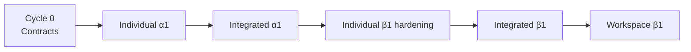

# Milestone Sequence: α1 → β1 → Workspace β1

Status: provisional roadmap, re-planned every four weeks  
Baseline date: 2026-08-16

このロードマップは日付の約束ではありません。

**順番の約束**です。

毎月の review で scope と日付を再計算し、未達機能を無条件で次月へ積み上げません。

---

# Roadmap principle

Workspace を先に作って未完成 product を接着しません。

---

# Cycle 0: 2026-08-17 → 2026-09-13

**Theme:** Architecture reset and first cross-product contracts.

Detailed plan: `06_INITIAL_4W_PLAN.md`

Gate:

- object responsibilities fixed
- Annotation draft shared
- Context Bundle draft shared
- beginner IDE shell feasibility known
- Note → IDE smoke path
- IDE → Writer context smoke path

No release promise.

---

# Cycle 1: provisional 2026-09-14 → 2026-10-11

**Theme:** Individual α1 closure.

This date is activated only if Cycle 0 gate passes.

## IDE α1 focus

- Project Home
- Markdown/preview
- Annotation reference
- Changes / Update / Sync
- publish preview / static output
- Desktop built-in + VS Code extension build paths

## Note α1 focus

- capture vertical slice
- canonical Annotation export
- robust local recovery
- static/PWA distribution

## Writer α1 focus

- core/provider/UI separation
- provider fallback
- explicit Context Bundle
- reviewable candidate lifecycle

## Gate

Each product independently completes its α1 acceptance checklist in `04_PRODUCT_GOALS.md`.

## Do not add

- Workspace GUI
- official model training
- Word/PDF production
- Hive

---

# Cycle 2: provisional 2026-10-12 → 2026-11-08

**Theme:** Integrated α1 and contract freeze candidate.

## Primary goals

- Note real export → IDE import
- IDE annotation reference → output
- IDE selected context → Writer
- Writer accepted text → normal Markdown workflow
- IDE Update / Sync
- static publish
- clean repository clone proves portability

## Contract work

Candidate freeze:

- Project v1
- Source v1
- Annotation v1
- Context Bundle v1

Only freeze contracts that have at least two producer/consumer paths or real fixtures.

## Release candidate

If gates pass:

- `MAGINALIA IDE α1`
- `MAGINALIA Note α1`
- `MAGINALIA Writer α1`

Release dates may differ; contract compatibility matters more than simultaneous tagging.

---

# Cycle 3: provisional 2026-11-09 → 2026-12-06

**Theme:** β1 hardening, not feature expansion.

## Focus

- migrations
- backups
- offline/auth/conflict recovery
- beginner terminology
- installation path
- packaging
- accessibility basics
- settings simplification
- documentation split user/contributor
- privacy disclosure
- dependency freeze candidates

## UX test

At least one non-developer humanities-user test of:

install → project → edit → history → sync → publish preview

## Do not add

- new large product area
- hosted collaboration
- autonomous AI agent

---

# Cycle 4: provisional 2026-12-07 → 2027-01-03

**Theme:** Individual β1 candidates and distribution.

## IDE

- normal-user installer candidate
- clean machine test
- stable project migration
- conflict recovery
- static shelf sharing

## Note

- installable PWA/static path
- backup/export confidence
- local/exported state visibility

## Writer

- normal-user package
- GUI provider settings
- personal dictionary/profile export
- crash-safe session

## Gate

Each product can be given to a non-programmer without asking them to configure a development environment.

---

# Cycle 5: provisional 2027-01-04 → 2027-01-31

**Theme:** Workspace β1 integration.

Workspace begins only after standalone β1 candidates exist.

## Build

- product detection
- capability/compatibility matrix
- project handoff
- Context Bundle handoff
- Annotation import handoff
- deep links / file handoff
- diagnostics
- official static download page integration

## Do not build

- hosted Workspace account
- central sync
- cloud research DB
- subscription enforcement in OSS clients
- duplicated IDE/Note/Writer domain logic

## Gate

Complete the Workspace β1 acceptance flow in `04_PRODUCT_GOALS.md`.

---

# After Workspace β1

Only then reconsider:

- Hive / global index
- managed AI gateway
- institutional Workspace
- real-time collaboration
- official Writer model commercialization
- hosted sharing services
- additional native clients

These need their own product discovery and architecture decisions.

---

# Monthly progress scorecard

Do not report progress as `% code completed`.

Use:

| Metric | Meaning |
|---|---|
| End-to-end flows passing | actual user value |
| Acceptance gates passed | release readiness |
| Supported contract versions | interoperability |
| Known P0/P1 bugs | risk |
| Manual setup steps for normal user | beginner UX debt |
| Core Code-OSS patch count | upstream maintenance debt |
| Required MAGINALIA backend services | operational debt |
| Cross-product direct dependencies | architecture debt |

Desired direction:

- flows ↑
- gates ↑
- setup steps ↓
- core patches low
- required backends low
- direct cross-product dependencies = 0

---

# Replanning examples

## If IDE UI takes twice as long

Do:

- keep vertical slice
- postpone cosmetic replacement
- accept standard VS Code surface where understandable
- isolate one necessary Desktop patch

Do not:

- stop Note/Writer contract work waiting for perfect IDE appearance

## If Note browser auth is difficult

Do:

- keep export/import first-class
- ship α1 without direct GitHub write

Do not:

- create a large account backend

## If Writer model quality is poor

Do:

- preserve mechanical fallback
- improve review UX/provider adapter

Do not:

- make dedicated model training block β1

## If Codex capacity drops

Priority order:

1. data safety
2. contract compatibility
3. end-to-end flow
4. tests/recovery
5. beginner UX blockers
6. cosmetic polish
7. backlog features
