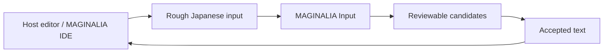

# Product Naming

Status: normative naming policy  
Date: 2026-08-16

## Current product names

- **MAGINALIA IDE**: the humanities-oriented Code-OSS desktop application and VS Code extension.
- **MAGINALIA Quote Capture**: the focused mobile/browser tool for ISBN → capture → OCR → correction → portable quotation/annotation export.
- **MAGINALIA Input**: the standalone Japanese input assistance tool for rough input → normalization/candidates → human review → accepted text returned to the host editor.
- **MAGINALIA Workspace**: the integration layer that connects compatible standalone products.

## Quote Capture rename

`MAGINALIA Note`, `MAGINALIA Note / Capture`, and product-level shorthand `Note`
are superseded names for **MAGINALIA Quote Capture**.

The new name is intentionally narrow. The product is not a general memo or notes
application. Its primary responsibility is to turn a quotation seen in a source
into a human-reviewed portable annotation.

## Input rename

`MAGINALIA Writer` and product-level shorthand `Writer` are superseded names for
**MAGINALIA Input**.

The product is not an editor and does not own the document being written. It is a
Japanese input assistance layer that can sit beside MAGINALIA IDE or another host editor.

MAGINALIA Input owns input normalization, protected-string handling, candidate generation,
provider abstraction, context consumption, fallback, and review. The host editor owns the
manuscript, file editing, document structure, history, and publishing.

This boundary is intentional: **Input must not become a second editor.**

## What is not renamed by these decisions

The following may continue to use legacy names where they are generic concepts or existing
technical identifiers:

- `notes/` directories in Research Projects
- note schemas for general notes
- existing command IDs and namespaces
- repository names such as `MY_marginallia` and `Uttate-writer`
- historical discussion documents
- existing Android / miniapp / Python package identifiers
- stored technical identifiers whose rename would require migration without user value

A product rename must not cause avoidable format or migration churn.

For new code, prefer product-neutral domain names or the current product name. Do not add new
`Writer`-branded public APIs merely because the legacy repository still uses that word.

## Interpretation of older planning documents

Within planning documents created before ADR 0009, product-level references to
`MAGINALIA Note`, `Note / Capture`, or a standalone `Note` product mean
**MAGINALIA Quote Capture**. Generic prose notes remain ordinary `note` objects.

Within planning documents created before ADR 0010, product-level references to
`MAGINALIA Writer` or standalone `Writer` mean **MAGINALIA Input**. References to a human
writer or generic writing activity keep their ordinary meaning.

When an older planning file is otherwise edited, update the product label then.
Active sprints and new specifications must use the current names immediately.
