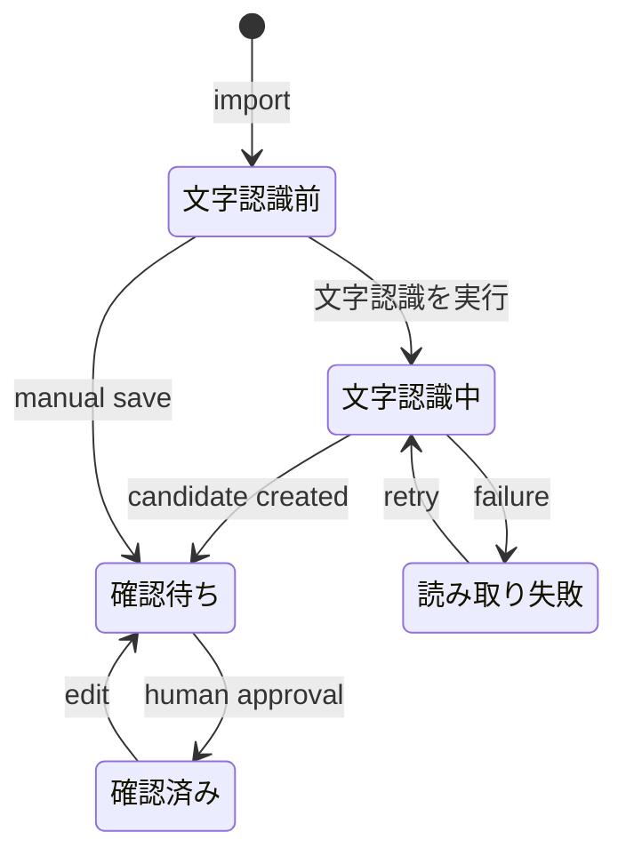

# MAGINALIA Quote Capture / Reviewer UX specification

Status: Implemented (P0)  
Products: MAGINALIA Quote Capture Android reference client / MAGINALIA Reviewer  
Date: 2026-08-29  
Authority: this specification is subordinate to accepted ADRs, `09_DECISION_LOG.md`, `00_MANIFESTO.md`, `11_UX_PRINCIPLES.md`, and `16_PRODUCT_NAMING.md`.

## 1. Current-state critique

### Android

The working capture loop was hidden inside a developer-oriented book screen. Book identity, metadata diagnostics, capture, package export, legacy ZIP export, GitHub review sync, and raw page rows had equal visual weight. The screenshot demonstrates the consequences: duplicate `Metadata` rows, English/Japanese mixing, wrapped and clipped action buttons, `pending`, `Guides: SUCCEEDED`, and millisecond timestamps rendered as page numbers. A user could not tell whether the next task was to photograph a page, select a quotation, or transfer completed captures.

The old list also mixed two different objects: a photographed page and a completed capture selected from that page. Because one page can contain more than one quotation, neither object may be treated as a simple done/not-done item.

### PC reviewer

The first viewport prioritized a browser-default file input and legacy GitHub publication instead of the working import-review-search loop. All functions were stacked on one page; opening a review left import, search, and publication controls above the actual workstation. Raw database states and OCR implementation controls were visible in the normal workflow. The review action was split into save and approve, permitting approval before the candidate text had been persisted.

## 2. Product UX principles

1. Every screen has one dominant next action.
2. The normal vocabulary is books, pages, quotations, review, and copying—not package IDs, database states, branches, or OCR JSON.
3. Source content dominates chrome. Book identity, page image, selected quotation, quotation text, page, and memo receive the strongest hierarchy.
4. Human choices remain authoritative. Detected text guides and OCR candidates are assistance, never silent replacements for selection or correction.
5. Transfer is an explicit, read-only snapshot. Export does not imply deletion, synchronization, or a durable sent state.
6. Japanese is the reference locale. Product names, ISBN, GitHub, and NDLOCR-Lite may remain proper nouns; surrounding instructions are Japanese.
7. Advanced and legacy access is preserved but removed from the ordinary path.
8. P0 changes presentation and orchestration only. It does not change `.magicap`, database schema, security boundaries, or core capture/OCR contracts.

## 3. Information architecture

### Android

```text
本棚
├─ 本を追加
│  └─ ISBNを読み取る / 手入力
├─ 本の詳細
│  ├─ 引用を追加
│  │  ├─ ページを撮影
│  │  ├─ 引用範囲を選ぶ
│  │  └─ ページ・メモ → 保存
│  ├─ PCに渡せる引用
│  ├─ 撮影したページ
│  └─ その他 → 書誌情報を更新 / 詳細設定
└─ 設定
   └─ 詳細設定 → GitHub / 旧形式 / 公開済み引用
```

### PC reviewer

A persistent left sidebar is used at desktop widths because review and library are repeated workspaces, not sequential wizard steps. It keeps the three stable destinations visible without competing with content. Below 980 px it becomes a bottom navigation.

```text
確認待ち
├─ Androidから引用を取り込む
├─ 状況: 文字認識前 / 文字認識中 / 確認待ち / 確認済み / 読み取りエラー
└─ 次に確認するもの
   └─ 引用を確認（二ペイン）
引用ライブラリ
└─ 検索 / 絞り込み / コピー / 開く
設定
└─ 詳細設定
   ├─ 旧形式ZIP
   ├─ GitHub接続情報
   └─ 旧GitHub公開
```

## 4. Android screen specifications

### 4.1 本棚

Component hierarchy:

```text
Scaffold
├─ TopAppBar: MAGINALIA / 設定
└─ LazyColumn
   ├─ Primary button: 本を追加
   ├─ Section heading: 本棚
   └─ Book cards
      ├─ cover or 表紙なし
      ├─ title
      ├─ authors
      └─ ISBN
```

The empty state is `本がまだありません` / `「本を追加」からISBNを読み取ってください。` The whole book card opens the book. No GitHub, sync, metadata state, or global transfer count appears here.

### 4.2 本の詳細

```text
Scaffold
├─ TopAppBar: back / title / その他
└─ LazyColumn
   ├─ BookIdentity: cover, title, subtitle, author, publisher · year, ISBN
   ├─ Primary button: 引用を追加
   ├─ WorkflowSummary
   ├─ Section: PCに渡せる引用
   │  ├─ supporting copy
   │  ├─ secondary CTA: PCへ送る
   │  └─ capture cards: selected crop, p.n or ページ未設定, memo
   ├─ Section: 撮影したページ
   │  └─ page cards: thumbnail, human page label, guide message, quotation count, 引用範囲を選ぶ
   └─ optional AdvancedBookActions
```

`引用を追加` is the only filled primary control. `PCへ送る` is tonal and appears only when at least one capture exists. Export copy must say that the file is saved for PC import and captures remain on the phone. Do not use `送信済み`: the contract has no sent-state tracking.

The `その他` menu contains `書誌情報を更新` and `詳細設定`. Raw metadata lookup state never appears.

### 4.3 ISBN entry

```text
Scaffold: 本を追加
└─ Column
   ├─ heading: ISBNバーコードを読み取る
   ├─ camera viewport
   ├─ explanation / validation message
   └─ manual disclosure
      ├─ ISBN-10 または ISBN-13
      └─ このISBNを使う
```

Camera permission copy is specific: `ISBNを読み取るためにカメラを使用します。手入力でも追加できます。` Invalid input: `有効なISBN-10またはISBN-13を入力してください。` New-book choice: `この本の本文はどちらですか？` with `横書き` / `縦書き`.

### 4.4 Capture

```text
Scaffold: ページを撮影
└─ Column
   ├─ instruction
   ├─ flexible camera preview
   ├─ error surface if needed
   ├─ Primary button: 撮影する
   └─ Secondary button: 端末の画像を使う
```

Avoid a fixed-height demo viewport. The preview consumes available height; actions stack vertically and remain at least 48 dp tall.

### 4.5 Region selection, page, and memo

```text
Scaffold: 引用範囲を選ぶ
└─ Scrollable column
   ├─ guide assistance message
   ├─ instruction
   ├─ page image canvas
   │  ├─ thin dashed detected-text guides
   │  └─ thick solid amber human selection with corner marks
   ├─ 範囲を選び直す
   ├─ ページ番号（任意）
   ├─ メモ（任意）
   ├─ Primary button: 保存
   └─ result / error surface
```

Guide messages are `文字の位置を調べています`, `文字の位置を検出しました`, or `文字の位置を検出できませんでした。手動で選べます`. The user may select while detection runs. A nonblank page must be numeric and within 1–100000. Save failure retains all inputs.

After success, replace the editor with:

- `引用を保存しました`
- `PCへ渡す準備ができました。`
- primary `次のページを撮る`
- secondary `同じページからもう一件`
- quiet `本に戻る`

### 4.6 Pending / ready captures

Normal UI calls these `PCに渡せる引用`. A capture card contains the image crop with the selected rectangle, `p.163` or `ページ未設定`, memo or `メモなし`, and `同じページから追加`. It never displays capture UUID, `pending`, OCR state, created-at milliseconds, or quotation text that Android does not possess.

Photographed pages remain a separate `撮影したページ` section. Their action is `引用範囲を選ぶ`; an existing capture does not make the whole page permanently complete.

### 4.7 PC handoff

Primary-facing copy is `PCへ送る`; supporting copy is `この本の引用2件を、PCで取り込めるファイルに保存します。書き出しても端末の引用は残ります。` The system file picker performs the existing explicit `.magicap` snapshot export. Success: `PC用ファイルを保存しました。引用はこの端末にも残っています。` Failure: `PC用ファイルを保存できませんでした。もう一度お試しください。`

The technical extension is visible in the chosen filename and Advanced documentation, not as the main task label.

### 4.8 Settings

```text
Scaffold: 設定
└─ Column
   ├─ このアプリについて
   └─ Details: 詳細設定
      ├─ 公開済み引用ライブラリ
      ├─ GitHub連携を設定
      ├─ すべての確認済み引用を取り込む
      └─ explanatory warning
```

Per-book Advanced additionally contains the legacy PC review ZIP and publication comparison. Advanced screens remain Japanese around necessary technical nouns.

## 5. PC screen specifications

### 5.1 Inbox / import

```text
AppShell
├─ Sidebar: MAGINALIA / 確認待ち / 引用ライブラリ / 設定
└─ Main: 確認待ち
   ├─ header / 一覧を更新
   ├─ ImportPanel
   │  ├─ Androidから引用を取り込む
   │  ├─ hidden strict file input
   │  ├─ ファイルを選択
   │  └─ 取り込む
   ├─ StatusGrid (explicit page counts)
   └─ QueueList
```

The normal picker accepts `.magicap` and `.magicap.zip`; generic `.zip` is available only at `設定 → 詳細設定 → 旧機能`. Empty queue: `確認待ちのページはありません` / `Androidから引用を取り込むと、ここに表示されます。`

State mapping:

| Internal | Japanese | Unit |
|---|---|---|
| `PENDING` | 文字認識前 | page |
| `RUNNING` | 文字認識中 | page |
| `NEEDS_REVIEW` | 確認待ち | page |
| `APPROVED` | 確認済み | page |
| `FAILED` | 文字認識に失敗 | page |

### 5.2 Review workstation

```text
Review view
├─ Header: 確認待ちへ戻る / book or ISBN / 引用を確認 / human status / page
└─ ReviewLayout
   ├─ MediaPanel (sticky at desktop)
   │  ├─ page image
   │  ├─ selected capture rectangle + label
   │  ├─ optional NDL regions / Android guides
   │  └─ non-color-only legend
   └─ Inspector
      ├─ 引用 n / total; 前へ / 次へ
      ├─ state-dependent callout
      ├─ 引用本文
      ├─ ページ
      ├─ メモ
      ├─ Primary action
      └─ collapsed OCR詳細
```

For `PENDING` or `FAILED`, offer `文字認識を実行` and, for phone-selected captures, `OCRを使わず入力する`. After OCR succeeds the normal form dominates; OCR execution is no longer the primary persistent control. Manual entry changes the callout to `画像を見ながら入力`.

The normal commit is one action: `PUT annotation → POST capture approval (or legacy page approval) → open the next unapproved capture`. Label it `承認して次へ`. If persistence succeeds but approval fails, say `変更は保存しましたが、承認できませんでした。` and keep the saved values visible.

`OCR詳細` contains region add/delete/save, selected region text, and `文字認識エンジン: NDLOCR-Lite`. It is a recovery tool, not required for ordinary review.

### 5.3 Library / search

```text
Library view
├─ heading and payoff copy
├─ Search form
│  ├─ 引用を検索
│  ├─ 検索
│  └─ Details: 絞り込み → 書名 / ISBN
├─ result count
├─ quote cards
│  ├─ quotation text
│  ├─ title or ISBN fallback / authors
│  ├─ page
│  ├─ memo
│  └─ コピー / 開く
└─ さらに表示
```

Opening the screen performs an empty-query browse of approved quotations. Quote text uses the editorial serif face and dominates each result. No raw review state, annotation ID, source page ID, or database field is shown.

### 5.4 Settings / Advanced

The visible settings card explains local data ownership. `詳細設定` is collapsed by default. Inside it, `旧機能` contains old ZIP import, GitHub credentials, and old GitHub publication. Publication requires explicit preview before confirmation and keeps raw JSON behind a nested disclosure.

## 6. Flow and state diagrams




Android does not gain a sent state. `.magicap` remains a read-only working-state snapshot.

## 7. Exact Japanese copy inventory

| Purpose | Copy |
|---|---|
| Android primary capture | 引用を追加 |
| Android transfer | PCへ送る |
| Android ready section | PCに渡せる引用 |
| Android page list | 撮影したページ |
| Missing page | ページ未設定 |
| Guide success | 文字の位置を検出しました |
| Guide failure | 文字の位置を検出できませんでした。手動で選べます |
| Save | 保存 |
| Save success | 引用を保存しました |
| PC nav | 確認待ち / 引用ライブラリ / 設定 |
| Import title | Androidから引用を取り込む |
| Import buttons | ファイルを選択 / 取り込む |
| OCR | 文字認識を実行 / もう一度文字認識 |
| Manual recovery | OCRを使わず入力する |
| Review fields | 引用本文 / ページ / メモ |
| Approval | 承認して次へ |
| Search | 引用を検索 / 検索 |
| Copy | コピー |
| Empty inbox | 確認待ちのページはありません |
| Empty library | 引用がまだありません |
| Generic error | 操作を完了できませんでした。もう一度お試しください。 |
| Import error | 引用を取り込めませんでした。ファイルを確認してください。 |
| OCR error | 文字を読み取れませんでした。もう一度試すか、本文を手入力してください。 |
| Save error | 変更を保存できませんでした。入力内容は画面に残っています。 |
| Partial approval error | 変更は保存しましたが、承認できませんでした。 |

## 8. Shared visual tokens

The system is deliberately small. Android maps these ideas to Material 3; PC uses CSS variables.

| Token | Android | PC | Use |
|---|---|---|---|
| Paper | `#FBF9F5` | `#F7F5F0` | app background |
| Raised paper | Material surface | `#FFFEFB` | cards, forms |
| Ink | `#29282B` | `#272623` | primary text |
| Subdued ink | `onSurfaceVariant` | `#66625B` | metadata/helper copy |
| Primary | `#4F557D` | `#285D75` | one primary action, active navigation |
| Selection | `#D48A32` | `#F4A43D` | human-selected quote rectangle |
| Success | semantic green | `#3F6B54` | completed/success |
| Error | `#9A3F3F` | `#9C3F38` | errors only |
| Spacing | 4, 8, 12, 16, 24, 32, 48 dp | .25, .5, .75, 1, 1.5, 2, 3 rem | layout rhythm |
| Radius | 8, 12, 16 dp | 6, 10, 16 px | inputs, cards, panels |
| Border | outline variant, 1 dp | `#D8D4CA`, 1 px | quiet separation |

Typography: system Japanese sans for UI; PC uses a Japanese serif only for the wordmark, quote text, and restrained numeric emphasis. Android hierarchy is `headlineSmall` for book identity, `titleLarge` for section headings, `titleMedium` for cards, `bodyLarge/bodyMedium` for content, and `bodySmall/labelMedium` for metadata. No marketing-scale display type.

Buttons: filled primary for the single next action, tonal/outlined secondary for transfer or alternatives, text/quiet for navigation and disclosures, destructive outline only for explicit legacy publication confirmation. Disabled controls retain their footprint, use reduced opacity, and never become the sole status explanation.

Desktop hover uses a slightly darker/lighter surface; focus is a 3 px amber outline with offset. Status is always text plus shape/marker, never color alone.

## 9. Responsive behavior

### Desktop

- 1180 px maximum content width; 236 px sidebar.
- Status cards: five columns above 1120 px, three below 1120, two below 720.
- Review is 56/44 two-pane with minimum 340/300 px. At 980 px and below it becomes one column; the image panel stops being sticky.
- Sidebar becomes a sticky bottom navigation at 980 px and below.
- Import and search actions stack below 720 px. Below 420 px, action buttons become full width.
- No horizontal overflow at 1366, 1024, or a 512 px effective viewport representing 200% zoom at 1024.

### Android

- Use a single vertical action stack; never place multiple long Japanese buttons in a fixed horizontal row.
- Cards and fields fill available width with 16 dp outer padding.
- Book identity may wrap metadata but keeps the cover between 92 × 128 and 92 × 142 dp.
- Page canvas scales to width and remains scrollable with fields; it must not force actions off-screen.
- At large font scale, labels wrap while buttons grow vertically; no fixed one-line button height.

## 10. Accessibility requirements

- Android touch targets at least 48 dp; PC controls at least 44 CSS px.
- Back, page image, thumbnails, cover, capture selection, and camera actions have semantic labels.
- All PC functions are reachable by keyboard in visual order. `:focus-visible` is unmistakable.
- Page landmarks, navigation labels, headings, form labels, live status, and error alerts are semantic.
- Human selection versus OCR regions differs by label, solid/dashed line style, and color.
- Text/background contrast targets WCAG AA; never encode workflow state only with hue.
- Reduced-motion preference disables nonessential animation/transition.
- Unsaved PC review edits trigger a leave warning.

## 11. Remove from primary UI

- duplicate/raw metadata state
- `.magicap` as a primary Android task name
- legacy PC review ZIP
- GitHub account/owner/repository/branch/token fields
- old GitHub publication panel
- raw OCR JSON and region manipulation
- internal page/capture/annotation IDs
- millisecond timestamps used as pages
- raw `PENDING`, `RUNNING`, `SUCCEEDED`, `FAILED`, or `pending`
- package IDs, blob SHA, database status codes, and diagnostics

These remain available only where technically required under Settings / Advanced / Legacy / Developer.

## 12. Preserve technically

- Jetpack Compose + Material 3, CameraX, ML Kit text-layout guides, Room, existing view models and repositories
- human-selected normalized rectangle, page number, and memo
- book-scoped, explicit, read-only `.magicap` snapshot export
- FastAPI loopback, host/origin/CSRF protection, SQLite workspace, strict importer
- synchronous explicit NDLOCR-Lite execution and all existing region recovery tools
- save and approval APIs, empty-query approved search, pagination
- Windows Credential Manager and preview-before-publish conflict controls
- legacy ZIP and GitHub publication as compatibility paths

## 13. Migration strategy

1. Ship presentation-only P0 using existing routes, entities, APIs, and contracts.
2. Keep old deep routes/functions callable from Advanced while removing their entry points from normal navigation.
3. Preserve all existing local data; there is no schema migration.
4. Update UI tests to Japanese reference copy and current DOM actions.
5. Validate the first viewport, narrow widths, keyboard focus, file filters, review orchestration, and overlay alignment.
6. In a later release, remove dead legacy HTML only after the new shell has shipped and rollback need has passed.

## 14. Prioritized implementation plan

### P0 — no data-contract or core-business change

- Japanese normal UI and domain vocabulary
- Android Material 3 theme, vertical hierarchy, book/capture/page cards, human-readable guide status
- Android Settings/Advanced relocation and explicit PC handoff copy
- PC three-view shell, strict import surface, state counts, queue, two-pane review
- atomic UI orchestration of save → approve → next
- first-class empty-query library, copy/open, pagination
- responsive and accessibility foundations
- root ASCII batch launcher

### P1 — focused read models and editing

- read-only inbox summary API with exact capture counts to avoid page-detail N+1
- pending capture edit/delete on Android with explicit confirmation and no export mutation
- review queue pagination for thousands of pages
- OCR availability/status endpoint and clearer setup guidance
- book bibliography fields in a future `.magicap` version, only through a versioned contract decision
- device and representative-page visual/accessibility validation

### P2 — separately decided product expansion

- optional background OCR queue after performance/failure design
- explicit Android ↔ PC result synchronization only with an accepted cross-product contract
- user-owned GitHub Quote Library workflow after publication/privacy decisions
- installer/executable that removes normal-user dependence on Python/uv/PATH

P2 GitHub work must not turn import or approval into automatic publication.

## 15. Acceptance criteria

### Android

- [ ] From an empty shelf, a Japanese-speaking user can find `本を追加` without explanation.
- [ ] A book screen presents `引用を追加` as the only filled primary action.
- [ ] No ordinary screen displays raw metadata/OCR state, internal IDs, or timestamps as pages.
- [ ] Completed captures and photographed pages are visually separate.
- [ ] A missing page is always `ページ未設定`.
- [ ] Guides remain advisory and the human rectangle is visually dominant.
- [ ] Save failure retains selection, page, and memo.
- [ ] `PCへ送る` states that data remains on the phone.
- [ ] 360/412 dp widths and 200% font scale do not create horizontal button rows or clipped labels.

### PC

- [x] First viewport shows import, status, and queue; GitHub is not visible.
- [x] Normal file input accepts only `.magicap` / `.magicap.zip`; old ZIP is under Advanced.
- [x] No list falls back to `source_page_id` as a page label.
- [x] Review uses aligned image overlays and two panes at desktop width.
- [x] Normal approval persists edits before approval and advances to the next capture.
- [x] OCR region editing is collapsed under `OCR詳細`.
- [x] Library opens as browsable empty-query search and quote text dominates results.
- [x] 1366 px, 1024 px, and 512 px effective widths have no horizontal overflow.
- [x] Visible focus, landmarks, labels, live statuses, 44 px controls, and non-color status cues are present.
- [x] Existing reviewer automated tests pass.

## 16. Codex-ready implementation briefs

### A. Android

Work in `APK/app/src/main/java/dev/digitalmarginalia/app/ui/MarginaliaApp.kt`, `MainActivity.kt`, the app theme package, manifest label, and Japanese resources. Preserve repositories, entities, view models, Room schema, camera/canonicalization behavior, and `.magicap` writer. Implement the component trees and copy in sections 4 and 7. Do not invent quote text, sent state, or capture completion. Do not expose GitHub/legacy actions outside Settings/Advanced. Verify resources with AAPT2, compile with explicitly selected JDK 17, run unit tests, then perform 360/412 dp and large-font device checks.

### B. PC reviewer

Work primarily in `APK/reviewer/src/marginalia_reviewer/ui.py` and narrow UI assertions. Keep FastAPI routes, database schema, importer, CSRF/origin controls, OCR worker, and publisher contracts unchanged. Render the three-view shell and state-driven two-pane review described above. Normal `.magicap` import is strict; legacy ZIP/GitHub remain under collapsed settings. `承認して次へ` must await annotation PUT before capture/page approval and preserve partial-failure truth. Keep OCR boxes aligned to the rendered image element. Run all reviewer tests and visually inspect 1366/1024/512 effective widths.
