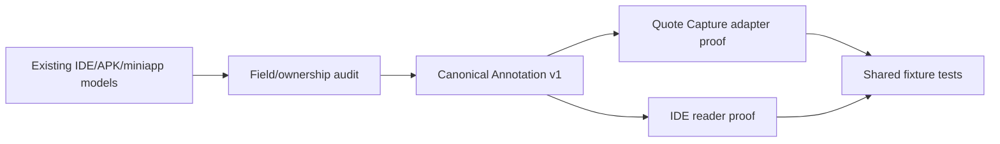

# Sprint 2026-W34

Dates: 2026-08-17 → 2026-08-23  
Status: Planned

## Primary Outcome

**IDE / Quote Capture / Input が今後独立して進化できるように、最初の canonical cross-product contract と IDE beginner-shell の技術境界を固定する。**

## Why now

既存3 product にはそれぞれ動く資産があるが、ここで feature を増やすと schema と UI の偶発的 coupling が増える。

α1 の前に「接続点」と「Code-OSSのどこまでを触るか」を固定することで、以後の Codex 作業を小さい packet にできる。

## User

PCやGitに詳しくない文系学生・研究者・書き手。

## In scope

### 1. Existing contract audit

Read and compare:

- `MAGINALIA_IDE/spec/**`
- `packages/format/**`
- `MY_marginallia/APK/contracts/**`
- `MY_marginallia/miniapp/src/core/**`
- Input context/session models relevant to integration in the legacy `Uttate-writer` repository

Create a field mapping for:

- Project
- Source / Book
- Annotation
- Context Bundle candidate

### 2. Canonical Annotation v1 draft

Create:

- schema
- TypeScript type/parser
- valid minimal fixture
- invalid fixture
- future-version fixture
- public/private field classification

Keep product-specific fields out of the minimal core unless two products need the same meaning.

### 3. Quote Capture adapter proof

Do not rewrite Quote Capture.

Create or specify one adapter:

```text
miniapp CaptureRecord -> canonical Annotation v1
```

A full UI integration can wait until Week 3, but the mapping must be testable.

### 4. IDE reader proof

IDE can validate/read the same canonical fixture and expose its stable ID/text/source reference to application logic.

No elaborate UI required this week.

### 5. Beginner-shell feasibility matrix

For each desired Desktop simplification, classify:

- VS Code Extension API
- product/default configuration
- small Code-OSS core patch
- not worth doing

At minimum investigate:

- first-run/Home
- MAGINALIA primary navigation
- reducing developer-centric Run/Debug/Terminal prominence
- default project-centric layout
- Settings entry
- status bar noise
- title/product branding

Use current upstream primary documentation/source, not memory alone.

### 6. Dual-distribution spike

Verify the extension source can be built toward:

- built-in Code-OSS bundle
- normal VS Code extension artifact/development package

If packaging is blocked, record the exact blocker. Do not redesign the whole extension to guess around it.

## Explicit non-goals

- final Annotation UI
- Quote Capture GitHub auth implementation
- Input UI changes
- turning Input into a document editor
- installer
- auto update
- Word/PDF
- Code-OSS visual redesign through broad core patches
- dependency major upgrades

## Units touched

| Unit | Responsibility | Change |
|---|---|---|
| `packages/format` | canonical portable contracts | Annotation v1 draft/fixtures |
| `extensions/maginalia` | IDE consumer + UI spike | minimal reader + feasibility proof |
| miniapp core/adapter | capture-specific → canonical | proof only |
| planning/docs | decisions/flows | update from evidence |

## Contracts touched

- Annotation v1: new draft
- Context Bundle: analysis only unless low-risk draft is needed for field ownership

## External dependencies

- VS Code / Code-OSS official Extension API and upstream source
- existing GitHub behavior only where needed for current code understanding

No new package should be necessary for the contract work.

## Flow



## Acceptance criteria

- [ ] Existing contracts are mapped rather than overwritten blindly
- [ ] Canonical Annotation v1 draft has version + stable ID + source relationship
- [ ] Product-specific raw OCR/image/device fields are not accidentally made universal core fields
- [ ] Valid/invalid/future fixtures exist
- [ ] IDE validates/reads the canonical valid fixture
- [ ] miniapp mapping to the same contract is demonstrated/tested
- [ ] UI feasibility matrix is complete
- [ ] Every proposed Code-OSS core patch has a reason extension/config cannot do it
- [ ] Dual-distribution path is proven or an exact blocker is documented
- [ ] Tests pass for changed code
- [ ] `plan/07_FLOWS.md`, Decision Log, ADRs are updated from implementation evidence

## Codex work packets

### Packet A: Contract archaeology

Read only, map current types/schema, propose minimal Annotation fields. No refactor.

### Packet B: Canonical contract

Implement schema/type/fixtures/tests in `MAGINALIA_IDE`.

### Packet C: Two-consumer proof

IDE reader + miniapp adapter/test. Avoid UI polish.

### Packet D: Workbench feasibility

Inspect official extension/product/core capabilities and write matrix. Prototype only the cheapest representative changes.

### Packet E: Dual package proof + documentation

Build/test packaging path, update ADR/plan.

## Risks

- R001 Code-OSS UI limits
- R003 schema drift
- R004 schema becomes product union
- R016 broad Codex refactor
- R025 explainability loss

## Decisions already governing this sprint

- ADR 0001 portable data
- ADR 0002 thin Code-OSS overlay
- ADR 0003 format versioning
- ADR 0004 Git/GitHub boundary
- ADR 0005 publication boundary
- ADR 0006 backend-minimal
- ADR 0007 beginner-first UI
- ADR 0008 dual extension distribution
- ADR 0009 Quote Capture naming
- ADR 0010 Input naming and non-editor boundary

## End-of-sprint report

Fill on or before 2026-08-23.

### Completed

- 

### Not completed

- 

### Evidence

- 

### What changes next week

- 
