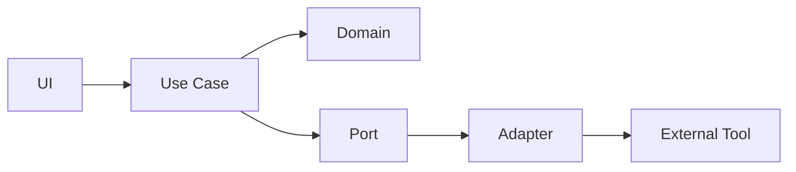
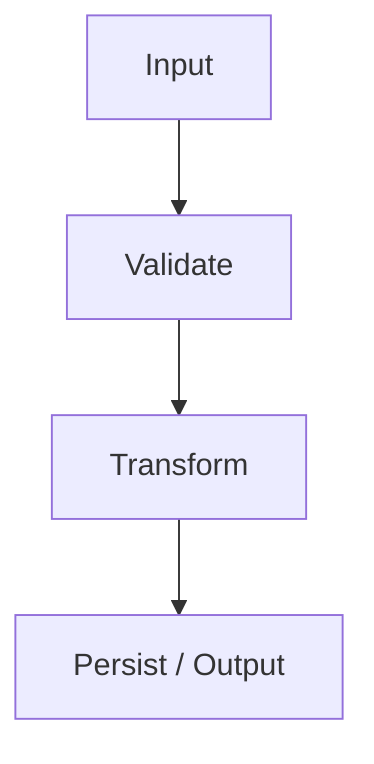
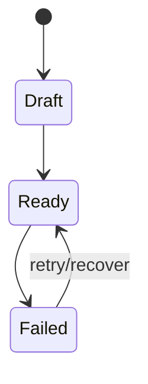

# Feature: <name>

Status: Draft / Accepted / Implemented  
Product: IDE / Quote Capture / Input / Workspace  
Milestone: α1 / β1 / Workspace β1

## 1. User problem

Describe the problem without technical implementation terms.

## 2. One-sentence responsibility

This feature/unit does exactly one thing:

> ...

## 3. In scope

- 

## 4. Non-goals

- 

## 5. Inputs / outputs

| Direction | Contract | Durable? | Owner |
|---|---|---|---|
| Input | | | |
| Output | | | |

## 6. Unit boundary

Mark which boxes this feature owns.

## 7. Object flow

## 8. State transition

## 9. Failure behavior

For each failure answer:

- what remains safe?
- what does the user see?
- what can they do next?

## 10. User-facing vocabulary

| Technical term | Normal UI term |
|---|---|
| | |

## 11. External dependency

- specialist/tool:
- adapter interface:
- replacement path:
- backend required?:
- why?:

## 12. Data/privacy

- durable data touched:
- data sent off-device:
- public/private boundary:
- secrets:

## 13. Compatibility

- contract version:
- migration:
- old client behavior:
- unknown future version behavior:

## 14. Tests

- [ ] pure unit tests
- [ ] contract fixture
- [ ] adapter failure test
- [ ] integration test
- [ ] manual beginner flow

## 15. Acceptance

Observable user outcome:

- [ ] 

## 16. Explainability check

A non-programmer project owner can explain:

- [ ] what this unit does
- [ ] where its data comes from
- [ ] where its data goes
- [ ] what happens when it fails
- [ ] which specialist/tool can be replaced
