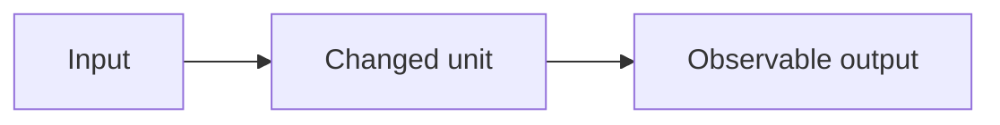

# Sprint YYYY-Www

Dates: YYYY-MM-DD → YYYY-MM-DD  
Status: Planned / Active / Done / Replanned

## Primary Outcome

One sentence only.

## Why now

How this advances the current α/β gate.

## User

Who benefits, stated without implementation language.

## In scope

- 

## Explicit non-goals

- 

## Units touched

| Unit | Responsibility | Change |
|---|---|---|
| | | |

## Contracts touched

- None / list versioned contracts

## External dependencies

- None / official API/tool and current assumption

## Flow

## Acceptance criteria

- [ ] Happy path
- [ ] Failure path
- [ ] Unit tests
- [ ] Contract tests if applicable
- [ ] Docs/diagram updated
- [ ] Normal UI does not require new developer terminology
- [ ] Portable data remains recoverable

## Codex work packets

1. 
2. 
3. 

## Risks

- 

## Decisions made

- Dxxx / ADR xxxx

## End-of-sprint report

### Completed

- 

### Not completed

- 

### Evidence

- test commands/results
- manual flow

### What changes next week

- 
